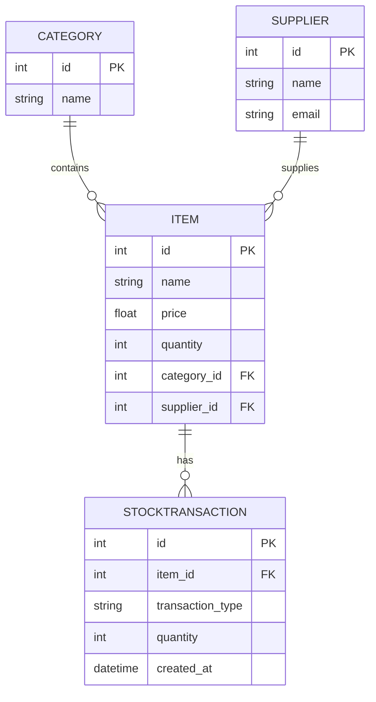

# Информационная система учёта товаров на складе

Учебный проект лабораторных работ №1–4 на Python, FastAPI, SQLModel и SQLite.
Система хранит товары, категории, поставщиков и записи складских операций.
Через REST API можно добавлять, просматривать, изменять, удалять и искать товары.

## Запуск в GitHub Codespaces

Команды выполняются в терминале из корня `applied-is-project-2026`.
Нужен Python 3.10 или новее. Для существующего Codespace сначала получите изменения
командой `git pull --ff-only origin main`. Если Git сообщает о локальных изменениях,
сначала сохраните их отдельным коммитом.

```bash
python -m venv .venv
source .venv/bin/activate
python -m pip install -r requirements.txt
python -m app.database.seed
python -m uvicorn app.main:app --host 0.0.0.0 --port 8000 --reload
```

При локальном запуске в Windows окружение активируется командой
`.venv\Scripts\Activate.ps1` в PowerShell.

В Codespaces откройте вкладку **Ports**, перенаправьте порт `8000` и нажмите
**Open in Browser**. Добавьте `/docs` в конец открывшегося адреса.
При запуске на своём компьютере Swagger доступен по адресу
[http://127.0.0.1:8000/docs](http://127.0.0.1:8000/docs).
Терминал с Uvicorn должен оставаться запущенным.

## Структура проекта

| Файл | Назначение |
| --- | --- |
| `app/main.py` | Создание FastAPI, таблиц при старте и подключение маршрутов |
| `app/database/models.py` | Четыре ORM-модели и связи между ними |
| `app/database/db.py` | Движок SQLite, контроль внешних ключей и сессии |
| `app/database/seed.py` | Начальное заполнение базы тестовыми данными |
| `app/routers/items.py` | Схемы входных данных, CRUD и фильтрация товаров |
| `tests/test_labs.py` | Автоматические проверки лабораторных №2–4 |

## Лабораторная работа №2

Реализованы таблицы `category`, `supplier`, `item`, `stocktransaction`.
Каждый товар относится к одной категории и одному поставщику. У товара может
быть несколько записей складских операций. Первичные ключи формируются базой.



Исходная концептуальная схема из лабораторной №1 сохранена в проекте.


Команда `python -m app.database.seed` создаёт `database.db` в корне проекта,
добавляет 3 категории, 3 поставщика, 5 товаров и 5 операций поступления.
Повторный запуск добавляет недостающие демонстрационные записи без дублирования
существующих товаров и их операций. Изменённые цены и остатки сохраняются.
Все вставки выполняются одной транзакцией. SQLite-файлы исключены через `.gitignore`.

## Лабораторная работа №3

| Метод | Адрес | Результат |
| --- | --- | --- |
| GET | `/` | Проверка работоспособности |
| GET | `/items` | Список товаров |
| GET | `/items/{item_id}` | Один товар или ошибка 404 |
| POST | `/items` | Созданный товар и статус 201 |

Входная схема отделена от таблицы. Название обрезается по краям и не может быть
пустым. Цена и количество должны быть неотрицательными, категория и поставщик
должны существовать. Передача `id`, неизвестных полей и некорректных значений
вызывает 422. Для каждого запроса `Depends(get_session)` открывает отдельную
сессию и закрывает её после завершения.

В Swagger раскройте `POST /items`, нажмите **Try it out** и отправьте пример.
На новой заполненной базе категория и поставщик с ID `1` существуют.
Для уже изменённой базы возьмите подходящие ID из ответа `GET /items`.

```json
{
  "name": "Клавиатура",
  "price": 15000,
  "quantity": 8,
  "category_id": 1,
  "supplier_id": 1
}
```

Сохраните `id` из ответа. Повторите запрос с `"price": -1` и убедитесь,
что получен 422 и дополнительный товар не появился.

## Лабораторная работа №4

| Метод | Адрес | Результат |
| --- | --- | --- |
| PATCH | `/items/{item_id}` | Изменение только переданных полей |
| DELETE | `/items/{item_id}` | Физическое удаление и статус 200 |
| GET | `/items?search=Мыш&min_price=1000&max_price=10000` | Поиск и диапазон цен |

Параметры фильтрации необязательны и применяются совместно. Границы цены включены
в диапазон. Запрос с `min_price > max_price` возвращает 422. Поиск выполняется
по буквальному фрагменту названия, включая символы `%` и `_`, через параметры SQL.

Для учебного сценария удаления настроен каскад на уровне ORM. При удалении товара
его складские операции удаляются в той же транзакции. Категория и поставщик
сохраняются. Это позволяет выполнить DELETE и для товаров из начального наполнения.

В Swagger выполните следующие проверки.

1. `GET /items` с `search=утбол` возвращает «Футболка».
2. `GET /items` с `min_price=1200` и `max_price=8500` возвращает «Блокнот», «Мышь» и «Футболка» на исходных данных.
3. `PATCH /items/{id}` созданной клавиатуры с телом `{"price": 14000}` изменяет только цену. Повторный GET показывает прежние название, количество и связи.
4. PATCH с `{"price": null}` или отрицательной ценой возвращает 422, запись остаётся прежней.
5. DELETE созданной клавиатуры возвращает 200. GET, PATCH и повторный DELETE этого ID возвращают 404.

## Автоматическая проверка

```bash
python -m pip install -r requirements-dev.txt
python -m unittest discover -s tests -v
```

Проверки используют отдельные временные SQLite-базы. Они охватывают структуру
и связи, повторное и частичное заполнение, запуск приложения и Swagger, полный
цикл CRUD, валидацию, фильтры, отсутствующие ID и удаление связанных операций.

## Ответы для защиты лабораторных №2–4

### Работа №2

1. ORM связывает Python-классы с таблицами и позволяет выполнять запросы через объекты. Класс описывает структуру, экземпляр представляет запись, а таблица физически хранит строки в БД.
2. `category_id` хранит внешний ключ в SQL. `category` даёт доступ к связанному объекту Python, а `back_populates` связывает обе стороны отношения.
3. Seeding создаёт реалистичные исходные данные для проверки запросов, связей и интерфейса.
4. `echo=True` выводит SQL-команды в терминал, что помогает понять работу ORM и найти ошибки запросов.
5. Код моделей хранится в Git для воспроизводимости структуры. Файл БД меняется при работе и может содержать пользовательские данные, поэтому он исключён из Git.

### Работа №3

1. REST API предоставляет доступ к ресурсам через HTTP. GET читает ресурс, POST создаёт новый.
2. Pydantic проверяет типы и ограничения данных до выполнения обработчика. В этом проекте ошибочные названия, цены и количества получают 422.
3. `Depends` управляет получением и завершением зависимости. Отдельная сессия на запрос предотвращает совместное использование изменяемой сессии несколькими запросами.
4. FastAPI строит OpenAPI-схему по маршрутам и моделям, а Swagger UI отображает её на `/docs`.
5. Статус 422 означает, что переданные данные не удовлетворяют схеме или правилам приложения.

### Работа №4

1. PUT обычно заменяет весь ресурс. PATCH меняет выбранные поля и позволяет отправлять меньше данных.
2. Query-параметры находятся после `?` в адресе и разделяются `&`, например `?search=Мыш&min_price=1000`.
3. `exclude_unset=True` отличает пропущенные поля от переданных. Явный `null` дополнительно отклоняется обработчиком, поскольку обязательные поля таблицы не допускают пустых значений.
4. Поиск перед удалением позволяет вернуть понятный 404, если записи нет. Само удаление и зависимые изменения завершаются транзакцией.
5. CRUD означает Create, Read, Update, Delete. В проекте им соответствуют POST, GET, PATCH и DELETE.
