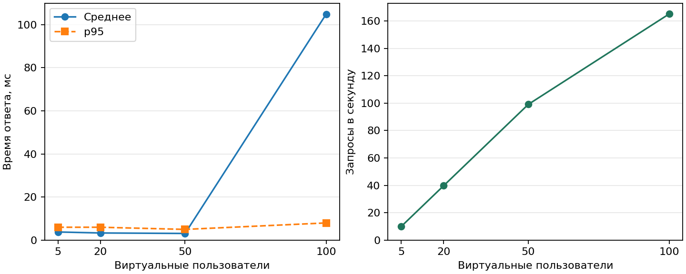

# Лабораторная работа №8. Нагрузка на каталог склада

25 ноября 2026 года Locust 2.47.0 отправлял запросы к Uvicorn 0.54.0 с одним рабочим процессом. Клиент и сервер работали на одном компьютере под Linux x86_64 с Python 3.12.14. Квоты среды составляли четыре процессорных ядра и 16 ГиБ памяти. База SQLite содержала пять демонстрационных товаров.

Каждый виртуальный пользователь выбирал между списком товаров (вес 2), поиском по слову «Мыш» (вес 1) и чтением карточки №1 (вес 1). После запроса он ждал случайное время от 0,25 до 0,75 с. Четыре ступени запускались последовательно с отдельной статистикой. Locust запускал 5, 20, 50 и 100 пользователей в секунду на соответствующих ступенях. Между ступенями сервер продолжал работать.

## Исходная серия с QueuePool

| Пользователи | Время, с | Запросы | Ошибки, % | Запросы/с | Среднее, мс | p95, мс | CPU, % ядра | Пик RSS, МиБ |
| ---: | ---: | ---: | ---: | ---: | ---: | ---: | ---: | ---: |
| 5 | 60 | 592 | 0,0 | 10,05 | 3,8 | 6,0 | 2,7 | 61,9 |
| 20 | 120 | 4733 | 0,0 | 39,74 | 3,34 | 6,0 | 8,3 | 64,6 |
| 50 | 180 | 17754 | 0,0 | 99,09 | 3,12 | 5,0 | 16,4 | 67,5 |
| 100 | 180 | 29607 | 0,14 | 165,19 | 104,89 | 8,0 | 24,3 | 79,1 |

p95 — время, в которое уложились 95% ответов по гистограмме Locust. Показатель CPU — средняя загрузка процесса Uvicorn при опросе примерно раз в секунду, где 100% соответствуют одному ядру. RSS — максимальный измеренный объём резидентной памяти того же процесса. [Измерения в CSV](lab8-load.csv)



## Сравнение 50 и 100 пользователей

При удвоении числа пользователей пропускная способность изменилась с 99,09 до 165,19 запроса/с. Среднее время ответа изменилось с 3,12 до 104,89 мс, а p95 — с 5,0 до 8,0 мс. Locust зарегистрировал 0 и 40 ошибок соответственно.

Загрузка CPU выросла с 16,4% до 24,3% одного ядра, пиковая память — с 67,5 до 79,1 МиБ. Эти цифры характеризуют чтение небольшого каталога через loopback. Для растущего склада стоит проверить пагинацию списка товаров на базе с реалистичным количеством строк и повторить измерения. Профиль конкурентных записей требует отдельного эксперимента.

## Проверка исправления при 100 пользователях

В исходной серии на 100 пользователях журнал Uvicorn зафиксировал исключение SQLAlchemy `TimeoutError`. Пул SQLite позволял одновременно занять 5 постоянных и 10 дополнительных соединений. Часть запросов ждала соединения 30 секунд и завершилась с HTTP 500. В файловой SQLite для этой системы применили `NullPool`. Теперь приложение открывает соединение для операции и закрывает его после возврата. Для проверки запустили новую копию сервера с новой демонстрационной базой и повторили ту же ступень на 180 секунд.

| Конфигурация | Запросы | HTTP-ошибки | Запросы/с | Среднее, мс | p95, мс | CPU, % ядра | Пик RSS, МиБ |
| --- | ---: | ---: | ---: | ---: | ---: | ---: | ---: |
| QueuePool | 29607 | 40 | 165,19 | 104,89 | 8,0 | 24,3 | 79,1 |
| NullPool | 35175 | 0 | 196,15 | 9,53 | 38,0 | 39,1 | 88,7 |

За повторный прогон сервер обработал все запросы успешно. Среднее время уменьшилось со 104,89 до 9,53 мс. При этом p95 составил 38,0 мс по сравнению с 8,0 мс в исходной серии. Долгие ожидания редких запросов влияют на среднее, даже когда доля таких запросов меньше пяти процентов.

## Повторный запуск

Выполните команды из корня репозитория в активированном виртуальном окружении.

```bash
python -m pip install -r requirements.txt -r scripts/load/requirements.txt
python scripts/load/run.py /tmp/warehouse-load-results
# Отдельный повтор контрольной ступени
python scripts/load/run.py /tmp/warehouse-100-results --users 100
```

Скрипт создаёт новый каталог вывода, запускает копию приложения на 127.0.0.1 с отдельной временной базой и выполняет весь профиль за девять минут плюс время запуска. Порт по умолчанию 18941 можно изменить параметром `--port`. В каталоге результатов сохраняются журналы, CSV Locust, секундные выборки CPU/RSS, сводка `summary.csv` и график `load.png`.

Исходный API для четырёх измерений доступен в коммите [836f158](https://github.com/Bekzz47/applied-is-project-2026/commit/836f158). Чтобы воспроизвести исходную конфигурацию, используйте отдельную копию этого коммита и перенесите туда каталог `scripts/load` из текущей версии. В актуальной версии обе команды используют исправленную конфигурацию.
