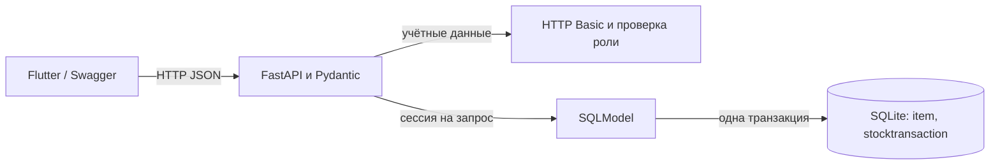
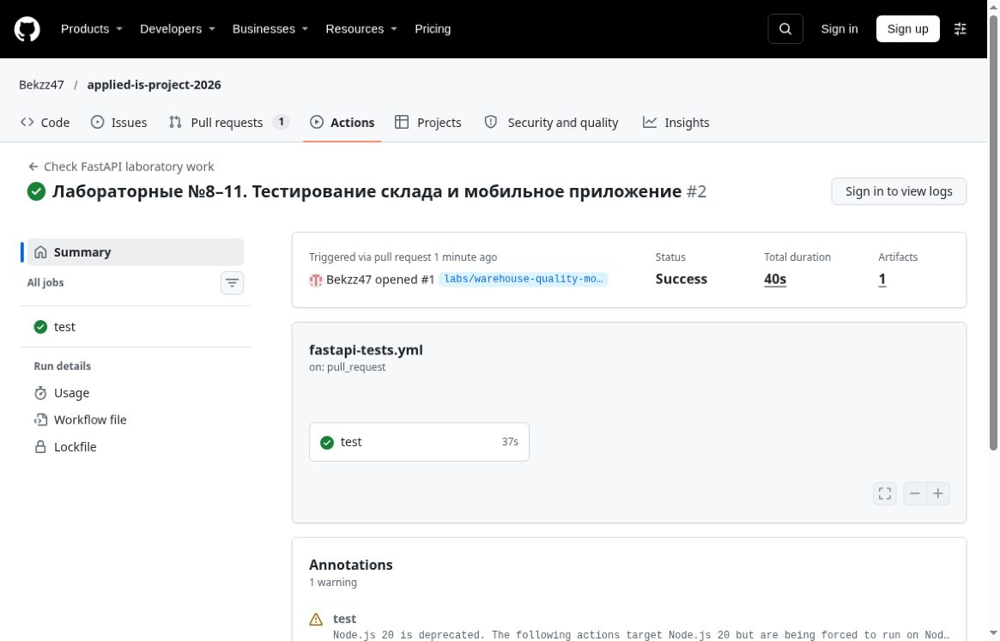

# Лабораторная работа №8. Проверка складской системы

**Вариант 8 — управление складом.** Цель работы — проверить, что API сохраняет согласованными журнал складских операций и остаток товара даже при ошибке записи или двух одновременных списаниях.

## Компоненты и границы тестов



| Компонент | Два случая для проверки | Где наблюдать результат |
| --- | --- | --- |
| Клиент | Пустая форма, разрыв связи | Валидация формы и сообщение об ошибке |
| API | Неверный JSON, неизвестный товар | Тело HTTP-ответа и код 400/404 |
| Аутентификация | Пустой пароль, неизвестное имя | 401 с одинаковым сообщением |
| Доступ по ролям | Анонимное чтение журнала, попытка записи читателем | 401 и 403 соответственно |
| Складская логика | Недостаточный остаток, одновременное списание | 409, остаток не опускается ниже нуля |
| База | Ошибка внешнего ключа, отказ вставки строки журнала | Проверка данных через независимую SQL-сессию после запроса |

## Результаты проверок API и БД

| Действие | HTTP | Содержимое ответа или состояние после запроса |
| --- | --- | --- |
| Создать и прочитать товар | 201, 200 | Товару присвоен ID, чтение по этому ID возвращает сохранённые поля |
| Заменить товар через PUT | 200 | Новое название записано в SQLite, пропущенное количество принимает значение 0 |
| Удалить товар и прочитать ещё раз | 200, 404 | Ответ об удалении, затем Item not found |
| Зарегистрировать поступление или расход | 201 | Создана строка журнала, остаток изменён на количество операции |
| Списать больше остатка | 409 | Остаток и число записей журнала прежние |
| Отклонить вставку в журнал после обновления остатка | 409 | Тестовый триггер SQLite вызывает отказ. Проверка из другой сессии подтверждает откат обеих записей |
| Одновременно списать весь остаток дважды | 201 и 409 | Одна новая операция и итоговый остаток 0 |
| Отправить повреждённый JSON или пустой объект | 400, 422 | Malformed JSON либо описание отсутствующих обязательных полей |

## Что исправлено

Журнал получил отдельный маршрут для проведения движения. Условное обновление остатка и вставка в журнал проходят в одной транзакции. Условие в самом UPDATE исключает двойное списание при параллельных запросах. Изменение карточки администратором остаётся отдельной учётной операцией.

Пароли поступают из переменных окружения. Проверки охватывают отсутствие учётных данных, пустой и неверный пароль, неизвестного пользователя, слабый пароль из конфигурации, роль читателя и отсутствие пароля в диагностике. SQL-параметры скрыты в диагностике SQLAlchemy. Bandit выполняет статический анализ Python-кода, а тесты ролей и транзакций проверяют поведение работающего приложения.

## Воспроизведение

```bash
python -m pip install -r requirements-dev.txt
python -m pytest -v
python -m bandit -r app -ll
```

Тесты запускают настоящее приложение с отдельной временной SQLite-базой. Набор лабораторных №2–4 проверяет прежний учебный режим, набор №8 создаёт собственные пароли для обеих ролей. Команды CI и файлы отчётов доступны в [GitHub Actions](../.github/workflows/fastapi-tests.yml).

См. также [измерения Locust для 5, 20, 50 и 100 пользователей](lab8-load.md).

В наборе 29 тестов pytest: 11 прежних и 18 для лабораторной №8. Первый [запуск в GitHub Actions](https://github.com/Bekzz47/applied-is-project-2026/actions/runs/45587501854) завершился успешно за 40 секунд. Артефакт `quality-reports` содержит результаты pytest в JUnit XML и вывод Bandit.


