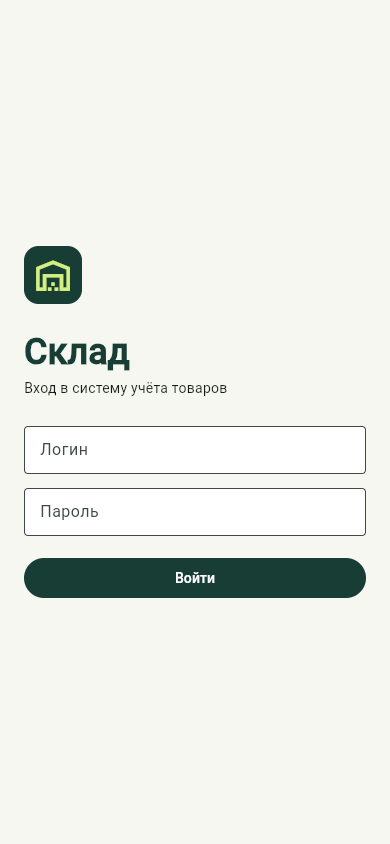
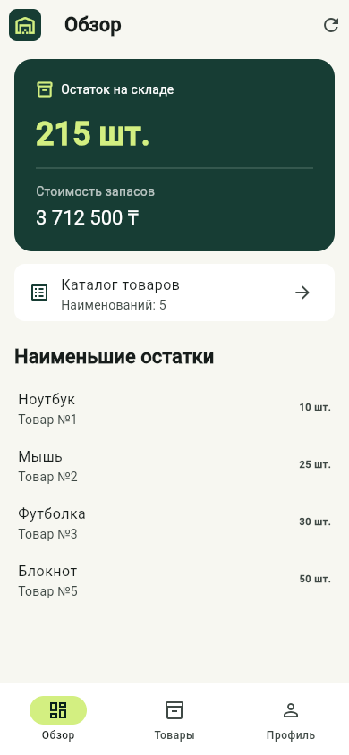
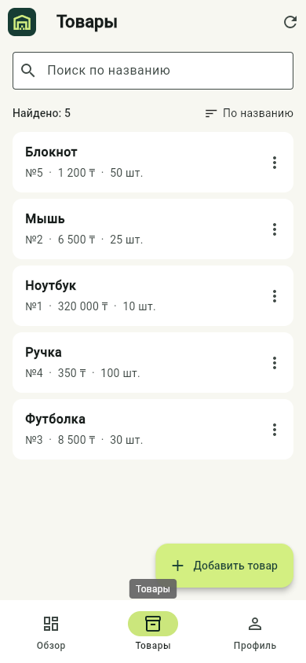
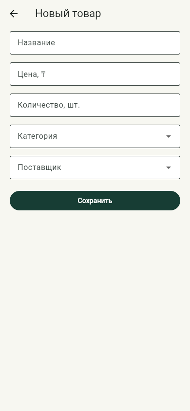
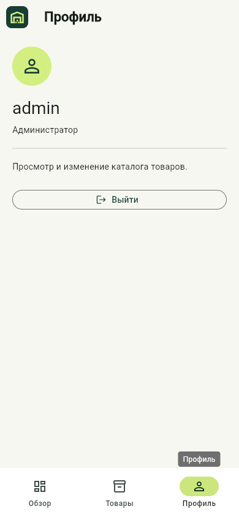

# №11. Проверка и защита мобильного склада

Мобильное приложение использует роли, справочники, товары и базу складской системы из №8. Для сверки с проектом доступны [пять экранов и схема архитектуры](lab9.md), [реализация функций](lab10.md), [отчёт о проверке API](../lab8.md) и [демонстрация на 6 минут](defense.md).

## План и условия

Заполнить учебную базу, настроить обе роли и запустить клиент по [инструкции](../../README.md#запуск-лабораторных-811). Для ручной проверки использовать карточку «Клавиатура учебная» и записать её ID. Отрицательные сценарии выполнять до удаления этой карточки. Перед каждым повтором убедиться, что предыдущая тестовая запись убрана. Автотесты сервера используют отдельные временные базы.

В запуске Flutter прошли все 10 сценариев виджетов и 8 проверок HTTP-клиента. Для виджетов использовался тестовый склад с состоянием, которое можно передать следующему экземпляру приложения. Серверный набор отдельно прошёл 29 проверок на временных базах SQLite. [Исходник сценариев](../../mobile/test/warehouse_ui_test.dart) · [HTTP-тесты](../../mobile/test/http_contract_test.dart)

| ID | Выполненный сценарий виджета | Фактическое наблюдение |
| --- | --- | --- |
| TC01 | Войти и открыть обзор | На тестовом складе с остатками 2 и 3 показано «5 шт.» |
| TC02 | Ввести неверный пароль, затем верный | Поле маскирует пароль, неверный вход отклонён, после исправления виден каталог |
| TC03 | Сохранить пустое название, цену −3 и количество 1.5 | Показаны три ошибки; в тестовом каталоге осталось две записи |
| TC04 | Добавить «Маркер», цена 12,5 и количество 4 | Карточка появилась с числовой ценой 12.5 и верными ID справочников |
| TC05 | Отменить удаление, затем подтвердить | После отмены «Карандаш» сохранился, после подтверждения осталась только «Бумага» |
| TC06 | Изменить «Карандаш» на «Карандаш HB» | Название обновлено в том же ID |
| TC07 | Найти «АНДА», затем отсутствующую строку | Поиск вернул «Карандаш», после второго запроса показано «Ничего не найдено» |
| TC08 | Открыть профиль администратора и выйти | Показана роль, после выхода имя очищено и доступна кнопка «Войти» |
| TC09 | Создать товар, пересоздать приложение и войти заново | Новый сеанс загрузил «Маркер» из сохранённого состояния тестового склада |
| TC10 | Смоделировать отказ связи и нажать «Повторить» после её восстановления | Ошибка исчезла, обзор снова показывает «5 шт.» |

На устройстве дополнительно проверить сортировку по остатку, повторный вход после полного закрытия процесса и отключение сети средствами ОС. Для проверки реального сохранения сравнить ID товара до и после перезапуска через GET /items/{id}.

## Ошибочные данные, права и доступность

| Проверка | Ожидаемое наблюдение |
| --- | --- |
| Ввести ошибочный пароль | Вход отклонён, пароль скрыт, ответ не выводит введённые данные |
| Оставить название пустым или ввести 201 букву | Форма указывает на название, запрос сохранения не отправляется |
| Ввести отрицательную цену или буквы вместо числа | Форма просит неотрицательную цену |
| Ввести дробное количество | Форма просит целое число от нуля |
| Пропустить категорию или поставщика | Поле показывает «Выберите значение» |
| Искать строку, которой нет в каталоге | Показано состояние пустого результата, текущий запрос можно очистить |
| Войти как reader | Элементы изменения каталога скрыты. Сервер отклоняет запрос записи с кодом 403 при настроенных ролях |
| Отправить запрос при отключённой сети | Клиент показывает ошибку и позволяет повторить действие |

На телефоне проверить открытие клавиатуры, прокрутку формы до «Сохранить», видимость выбранного раздела и отсутствие обрезанных сообщений. На узком экране увеличить размер системного текста, открыть карточку с длинным названием и проверить доступность меню записи. Отдельно проверить кнопку «Назад» и отмену удаления. Эти наблюдения требуют запуска на выбранном устройстве.

## Результаты и регрессии

Серверные тесты проверяют запись и повторное чтение из SQLite, ошибки валидации, роли и удаление связанных операций. Тесты HTTP-клиента проверяют получение роли, очистку учётных данных, передачу JSON с кириллицей и безопасное отображение ошибок. В журнале каждого запуска GitHub Actions видны команда, версия проверенного кода и результат. [Проверки проекта](https://github.com/Bekzz47/applied-is-project-2026/actions)

| Дефект | Шаги для повторения | Важность | Исправление и результат повторной проверки |
| --- | --- | --- | --- |
| MOB-01. Ответ с HTTP 200 мог вызвать необработанную ошибку разбора | Запросить каталог у тестового сервера, который вместо списка товаров возвращает HTML, null или карточку с пропущенными полями | Высокая — загрузка каталога прерывалась | Клиент обрабатывает ошибки формата и структуры. Три варианта прошли с сообщением «Некорректный ответ сервера.» |
| MOB-02. После отзыва доступа клиент мог продолжать отправлять старые учётные данные | Успешно войти, вернуть 401 на DELETE, затем запросить каталог | Высокая — локальные сведения о сеансе устаревали | Ответ 401 очищает учётные данные. Тест подтвердил пустое имя и отсутствие заголовка Authorization в следующем запросе |

Исправления клиента и проверяющие их сценарии доступны в [истории изменения мобильного клиента](https://github.com/Bekzz47/applied-is-project-2026/commit/d4b3d2d).

Воспроизведение автоматической части:

```bash
python -m pytest -v
cd mobile
flutter analyze
flutter test
```

Реализация и проверки доступны в [коде Flutter](../../mobile/lib), [мобильных тестах](../../mobile/test), [серверных тестах](../../tests) и [настройках Actions](../../.github/workflows). Повторяемые проверки HTTP и SQLite фиксируют поведение данных. Ручной прогон на устройстве дополнительно проверяет клавиатуру, касание и системную навигацию.

## Проверка интерфейса с работающим сервером

В Chromium при размере окна 390 × 844 выполнен вход, открыты обзор, каталог, форма добавления и профиль, затем выполнен выход. Клиент получил из тестовой SQLite-базы пять карточек с общим остатком 215 штук на сумму 3 712 500 ₸. Первый запуск без доступа к серверу шрифтов показал пустые надписи. После включения кириллицы и знака тенге в сборку повторный просмотр подтвердил читаемость интерфейса.

| Вход | Обзор | Каталог | Форма | Профиль |
| --- | --- | --- | --- | --- |
|  |  |  |  |  |

Android APK собирается в GitHub Actions. На странице успешного запуска **Warehouse mobile** откройте **Artifacts → warehouse-android-debug**. Для демонстрации на Android-эмуляторе запустите сервер согласно README. Фактические изображения выше сняты с веб-сборки Flutter.
