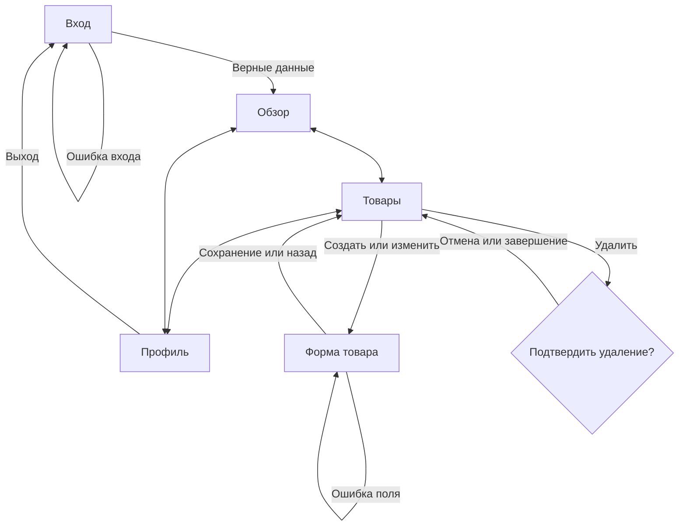
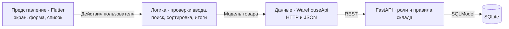

# №9. Проектирование мобильного складского учёта

Сотруднику склада нужно узнать, сколько товара осталось, пока он стоит у полки. Администратору нужно завести новую карточку, исправить цену или убрать ошибочную запись. Обе роли работают с каталогом складской системы из работы №8. В нём хранятся товары, категории, поставщики и история складских операций. Цены указаны в тенге, остатки измеряются в штуках.

## Пять экранов

Скачайте [интерактивный макет](prototype.html) и откройте его в браузере. Нажмите «Войти», найдите «Мышь» в разделе «Товары», откройте форму изменения, вернитесь в каталог и перейдите в профиль. Макет использует демонстрационные данные. Работающий клиент подключается к серверу в [лабораторной №10](lab10.md).

| Экран | Действия и наблюдаемый результат |
| --- | --- |
| Вход | Пользователь вводит имя и скрытый пароль. После проверки на сервере открывается обзор. При неверном пароле экран входа остаётся открытым. |
| Обзор | Сотрудник видит сумму остатков, стоимость запасов, число наименований и позиции с наименьшим остатком. |
| Товары | Сотрудник ищет подстроку в названии, сортирует по названию либо количеству. Администратор может добавить, изменить и удалить товар. |
| Новый товар / Изменить товар | Администратор вводит название, цену, количество и выбирает значения из справочников. После сохранения каталог перечитывается. При ошибке форма остаётся открытой. |
| Профиль | Пользователь видит текущую роль и завершает сеанс. Для следующего входа нужны учётные данные. |

## Маршрут пользователя

Три постоянных раздела доступны из нижней панели. У формы есть отдельный экран и возврат в каталог. Подписи полей остаются видимыми при вводе. В длинной форме используется вертикальная прокрутка. Сообщение об ошибке показано рядом с данными, которые нужно исправить.

## Три слоя

| Компонент | Решение |
| --- | --- |
| Название / основной пользователь | Складской учёт / сотрудник склада, администратор каталога |
| Главный и дополнительные экраны | Обзор, вход, каталог, форма карточки, профиль |
| Данные и хранение | Товар связан с категорией и поставщиком по ID. Единая база SQLite находится на стороне сервера. |
| Навигация | Нижняя панель между разделами, отдельный маршрут формы, диалог подтверждения удаления |
| Основные функции | Вход, обзор, поиск, сортировка, создание, изменение, удаление, выход |

Серверное хранение позволяет веб-интерфейсу, Swagger и смартфону читать один и тот же актуальный остаток. После перезапуска приложения пользователь входит повторно и загружает каталог с сервера.

Пять переходов макета, вход, поиск примера, открытие форм создания и изменения, профиль и выход проверены в Chromium. [Снимки реализованного интерфейса](lab11.md#проверка-интерфейса-с-работающим-сервером)
